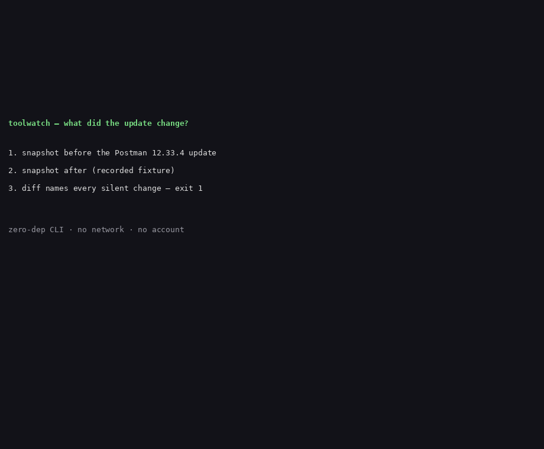

# toolwatch

Snapshot your dev-tool trust surface and diff it across updates — so the next silent plugin install, hook registration, or remote endpoint shows up in one command instead of a post-mortem.

Postman 12.33.4 silently auto-installed Claude Code and Codex AI plugins, wrote a trusted hash for its own SessionStart hook, and opened a remote MCP connection (postman-app-support#14370). After any dev-tool update, `toolwatch diff` answers the question no vendor answers for you: **what did the tool I updated yesterday do differently?**

```sh
toolwatch snapshot --out before.json
# ... update your tools ...
toolwatch snapshot --out after.json
toolwatch diff before.json after.json   # exit 1 when something trust-relevant changed
```



## What it watches

| Collector | What is snapshotted |
|---|---|
| VS Code | extensions (name + version + hash) and MCP servers in settings |
| Claude Code | plugins, hooks (event + matcher + command hash), MCP servers |
| Cursor | extensions and MCP servers |
| Postman | plugin directories under the app data dir (best effort, see below) |
| Shell | startup files (`.bashrc`, `.zshrc`, `.profile`, …) — hashed, never copied |
| Git hooks | `.git/hooks` of repos passed via `--repos` (opt-in, default off) |
| Remote endpoints | scheme + host of every configured MCP endpoint (no credentials, ever) |

Each collector reports `ok` / `not-installed` / `error` and never crashes on a missing tool. A snapshot is one JSON file with a sha256 fingerprint of the whole surface.

## Install

Install from source (no published npm package yet):

```sh
git clone https://github.com/techdevfun/toolwatch.git
cd toolwatch
npm install
npm run build
node dist/cli.js --help
```

Node 20 or later. Zero runtime dependencies.

## Usage

```sh
# Baseline your machine (do this before an update, or right after a clean setup)
toolwatch snapshot --out baseline.json

# After an update, compare the live machine against the baseline
toolwatch check --baseline baseline.json
# No drift — current state matches the baseline.        (exit 0)

# Or diff any two snapshots
toolwatch diff before.json after.json [--json] [--strict]

# Keep watching until something changes
toolwatch watch --baseline baseline.json --interval 300
toolwatch watch --baseline baseline.json --once   # a single check
```

Example diff — the Postman 12.33.4 shape, replayed from recorded fixtures (see `scripts/replay-postman.js`):

```
+ ADDED   claude-hook          claude-code:hook:SessionStart:*
           command postman-ai-bridge --session-start --trusted-hash a1b2c3d4
+ ADDED   claude-mcp-server    claude-code:mcp:postman-remote
           http https://mcp.postman.example
+ ADDED   postman-plugin       postman:plugin:claude-code
           version 1.0.0 · dir .config/Postman/plugins
+ ADDED   postman-plugin       postman:plugin:codex
           version 1.0.0 · dir .config/Postman/plugins
+ ADDED   remote-endpoint      endpoint:https://mcp.postman.example
           via claude-code mcp server "postman-remote" (http)
~ CHANGED vscode-extension     esbenp.prettier-vscode
           version 12.4.0
        -> version 12.5.0

6 change(s): 5 added, 1 changed, 0 removed.
DRIFT: 6 trust-relevant change(s) — review, then re-baseline with 'toolwatch snapshot'.
```

### Exit codes

| Code | Meaning |
|---|---|
| 0 | Snapshot written, or no trust-relevant change |
| 1 | Trust-relevant addition or change found (the CI gate) |
| 2 | Usage error, unreadable snapshot, or IO error |

By default only additions and changes gate; removals are reported but exit 0. Pass `--strict` to gate on removals too. A version bump shows as one `CHANGED` row (old version → new version), not as an add/remove pair.

### CI gate

```yaml
- run: node dist/cli.js check --baseline baseline.json
```

Commit a `baseline.json` from a known-good machine, then fail the build when the runner's trust surface drifts. See `examples/github-actions.yml`.

## Honest limits

- **Detection, not protection.** toolwatch detects changes in the trust surface. It does not sandbox tools, block installs, or judge whether a plugin or MCP server is malicious. If your only question is "is this MCP server malicious", use [mcp-audit](https://pypi.org/project/mcp-audit-scanner/) — it goes deeper on that leg than toolwatch ever will.
- **Point-in-time snapshots, one machine.** No daemon, no fleet, no realtime events. A change made and reverted between two snapshots is invisible.
- **Config surface only.** A tool that changes behaviour without touching any collected config (extension, plugin, hook, MCP entry, endpoint, git hook, shell file) is invisible to toolwatch. No blocking or sandboxing claims are made anywhere in this repo.
- **Linux/macOS paths in v0.1.0.** Windows config paths are not covered yet (roadmap).
- **Postman plugin paths are best effort.** The collector reads the known plugin directories under `~/.config/Postman` and `~/.local/share/Postman`; sandboxed installs (flatpak/snap) with different layouts may report "not installed" — honestly, rather than guessing.
- **Shell files are hashed, never copied.** Only a count of suspicious-looking lines (for example `curl … | sh`) is stored, and that count is a heuristic, not a verdict.
- **Snapshots are audit artifacts.** They list your extensions, hook commands, and endpoint hosts. Do not commit them to a public repo.

## Where rivals beat us

- **mcp-audit** beats toolwatch on MCP depth: tool-poisoning detection, live server inspection, credential-exposure patterns, cross-server toxic flows, SARIF output, and a signed advisory feed. toolwatch records that an MCP server appeared or changed; it does not judge its tool descriptions.
- **osquery** beats toolwatch on fleet scale and realtime events: a daemon with file/process/socket streams across thousands of hosts, plus a SIEM for correlation. toolwatch is point-in-time snapshots on one machine.
- **Nomos** beats toolwatch on verifying agent output: 42 AST gates on what an agent changed in a repo. toolwatch never looks at repo content.
- **Every rival with a dashboard** beats toolwatch on reporting: v0.1.0 has a terminal table and JSON, no HTML dashboard, no alerting channels.

The wedge: none of them answers "what did the dev tool I updated yesterday do differently" across the *whole* trust surface in one local command with zero setup. That is the one thing toolwatch does.

## Roadmap

- Windows collector paths
- VS Code Insiders paths
- `--watch` alerting channels (email/webhook) — currently exit code only
- HTML report for a diff
- npm package (pending maintainer token decision)

## Development

```sh
npm install
npm run build        # tsc, strict
npm test             # node --test test/unit.test.js test/e2e.test.js
npm run test:live    # live smoke on this machine (no network)
node scripts/preflight.js    # Rule 7: English-only + internal-name scan
node scripts/replay-postman.js  # Postman 12.33.4 shape through the real pipeline
```

## License

MIT — see [LICENSE](LICENSE).
